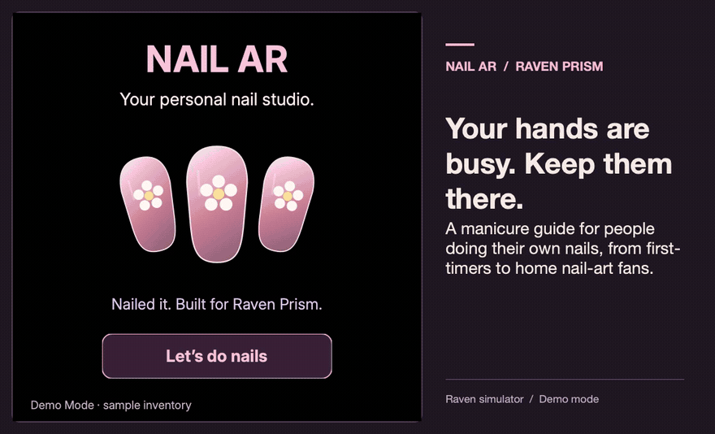
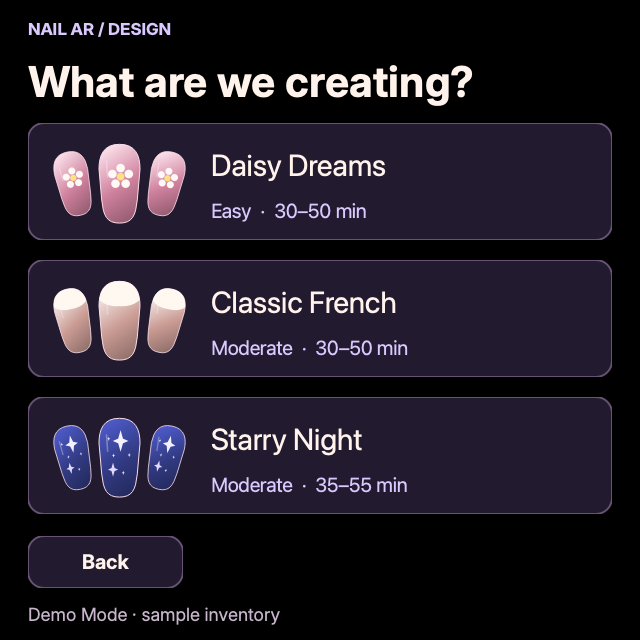
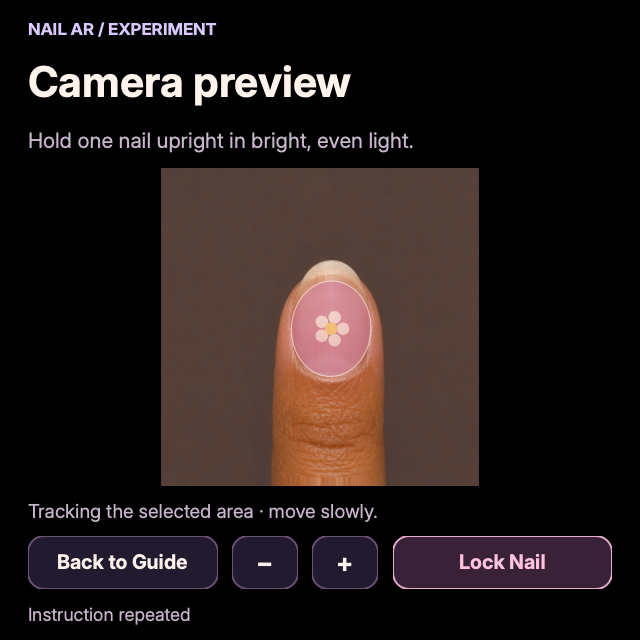
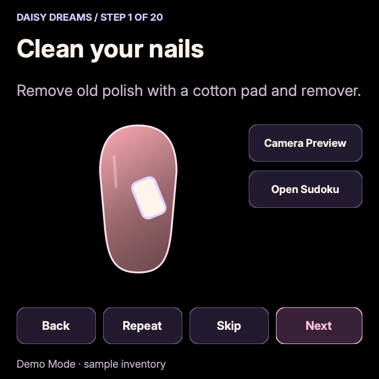
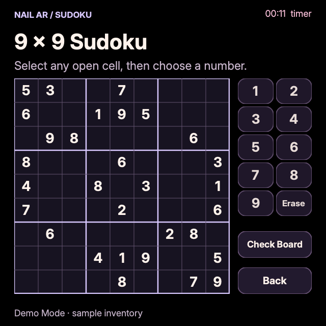

# Nail AR

*Nailed it. Built for Raven Prism.*

Nail AR is a hands-free manicure guide for Raven Prism. It’s for people who do their own nails at home, from beginners learning the order of a manicure to nail-art fans trying a new design.

When one hand holds a brush and the other has wet polish, reaching for a phone to pause a tutorial or scroll to the next step interrupts the manicure and risks a smudge. With Raven, look at a control and select it with a double blink or dwell. You can advance or repeat an illustrated step, check a timer, or play Sudoku without putting down your tools or touching a screen.

## Watch the full demo

[](assets/demo/nail-ar-demo.mp4)

The 1:33 walkthrough runs in the Raven simulator with sample inventory. The pink ring shows simulated gaze. The camera preview uses a generated nail image as its sample feed, and Nail AR draws and tracks the Daisy Dreams overlay in that feed. The walkthrough compresses the manicure steps and drying breaks.

[Open the full-resolution MP4](assets/demo/nail-ar-demo.mp4)

## Screenshots

| Choose a design | Preview an overlay on a nail |
| --- | --- |
|  |  |

| Follow the illustrated guide | Play Sudoku while the timer runs |
| --- | --- |
|  |  |

[Welcome](assets/demo/welcome.png) · [Sample inventory](assets/demo/sample-inventory.png) · [Drying options](assets/demo/drying-options.png) · [Sudoku digit entry](assets/demo/sudoku-entry.png) · [Manicure complete](assets/demo/manicure-complete.png)

## Install and launch

Use Python 3.10+. Clone Nail AR and the Raven SDK into the same parent directory.

```sh
git clone https://github.com/jayasrisng/nail-AR.git
git clone https://github.com/RavenResonance/raven-framework.git
cd nail-AR
python3 -m venv .venv
.venv/bin/python -m pip install -r requirements.txt
.venv/bin/python main.py --demo --narrate
```

On Windows, use `py -m venv .venv` and substitute `.venv\Scripts\python.exe` for `.venv/bin/python`. Launch from a desktop session so Qt can open the simulator. The simulator uses the cursor as eye gaze and clicks as selection. On Raven Prism, look at a control and use your configured selection gesture, such as a double blink or dwell.

- `--demo` enables labeled sample inventory and sets the optional timer preset to 15 seconds. Live inventory scanning and cloud voice are disabled in this mode. The local camera preview is still available.
- `--dry-seconds 120` sets an initial duration. **Drying Options** lets you select a preset or adjust it in 30-second increments. Start, pause, resume, or cancel the timer there. **Continue**, **Skip Wait**, and **Back** all leave a running timer intact.
- A timer ending or being skipped does not determine whether polish is dry or cured. Use the product’s instructions, including the specified lamp for gel.
- `--narrate` enables optional speech. macOS uses its built-in `say` for offline narration.
- Press `/` to type a voice command, `Enter` to submit, or `Esc` to dismiss. `F2`, `F3`, and `F4` send Next, Back, and Repeat.

## Live camera and voice

Set `OPENAI_API_KEY` in your environment, then run `.venv/bin/python main.py --narrate`. Set `NAIL_AR_VISION_MODEL` if you want a different image-capable model. Grant camera and microphone access when prompted. **Scan Workspace** captures a real Raven Camera frame and sends it to the configured vision model. Every item is reported as **Found**, **Not visible**, or **Uncertain**. You can confirm an item manually, rescan, or explicitly choose **Continue with Gaps**. If camera capture or vision fails, the app reports the failure and offers **Demo Mode** as a separate action.

Select **Voice command** to record, then **Stop listening** to transcribe. Commands include “Next,” “Back,” “Repeat,” “Skip,” “Skip wait,” “Resume,” “Start timer,” “Pause timer,” “Resume timer,” “Cancel timer,” and “Open Sudoku.” The puzzle also accepts “Row one column three,” “Enter four,” “Erase,” and “Check board.”

Simulator speech through Raven Speaker can require the optional audio extra:

```sh
.venv/bin/python -m pip install -e '../raven-framework[audio-simulator]'
```

## Camera preview prototype

From any tutorial step, select **Camera Preview**. In bright, even light, hold one nail upright and align it with the oval. Use **−** or **+** to resize the oval, then select **Lock Nail**. OpenCV uses a nearby contour if it fits the guide and otherwise starts from the oval you aligned. Move slowly and re-lock if the guide loses tracking. This follows a selected region in the camera image, and overlay placement is approximate. **Back to Guide** always restores the illustrated instruction.

The overlay is drawn inside the camera preview and is processed locally. It does not anchor the design to the physical nail in the wearer’s field of view.

For device deployment, set `RAVEN_APP_ID` and `RAVEN_APP_KEY` and use Raven’s documented `deploy` command.

## Sudoku and verification

All 81 cells and the number pad stay visible throughout the game. Select any editable cell directly, then choose a digit. **Erase** clears an editable cell. **Check Board** identifies incorrect entries. Original clues, entries, the selected cell, and elapsed play time are stored locally in `~/.local/share/nailpilot/sudoku-v1.json`. The original save location is retained so existing boards load after the rename. Set `NAIL_AR_SAVE_PATH` to use a separate board, such as for a demo. Moves save immediately and elapsed play time is checkpointed every two seconds while the puzzle is open.

```sh
.venv/bin/python -m unittest discover -s tests -v
```

Tests cover the unique solution, save and restore, repeated drying breaks, timer controls and navigation, scan status handling, frame handoff, tracker fallback, and viewport bounds at runtime size and at 720×720.

## Live demo for judges

1. Launch with `--demo --narrate`. Choose **Daisy Dreams**, then **Demo Mode** to show sample inventory. Confirm uncertain items or explicitly continue with gaps.
2. Open **Camera Preview** from a tutorial step to see the local camera feed. Center one nail in the oval, select **Lock Nail**, and move slowly to see the overlay follow the selected area. Use **Back to Guide** to return.
3. At a drying step, open **Drying Options**. Start the optional timer and choose **Play Sudoku**. Select row 1 column 3 directly on the board, then enter **4**. Back out and choose **Skip Wait**. Reopen Sudoku from the next step and show that the move and selection were saved.
4. Keep advancing while the timer runs. The timer ends with a small notification and leaves the current screen in place.

## Built with Raven

Nail AR is built on the [Raven SDK](https://github.com/RavenResonance/raven-framework) and adapted from the [Raven Starter Project](https://github.com/RavenResonance/raven-starter-project). The starter examples are still available in [`examples/`](examples/).
